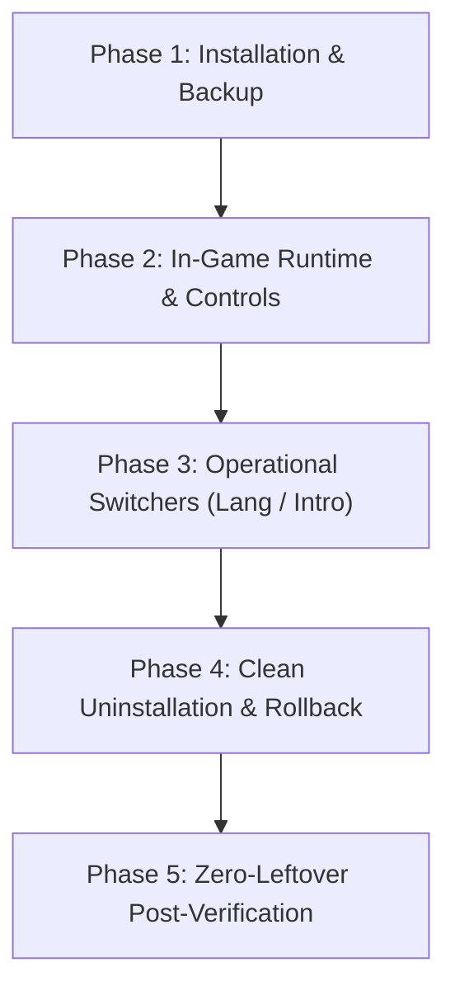

# AGENTS.md — Need for Speed: Underground 2 (R36H / R36S PortMaster Guide)

This document serves as the authoritative operational and development reference for AI agents and developers working on the **Need for Speed: Underground 2 (Recompiled)** port running on the **R36H / R36S** handheld gaming console.

> [!NOTE] Detailed Engineering Knowledge Base
> Full reverse-engineering discoveries, ABI stack contracts, subtitle opcode disassembly, and binary structures are documented in **[`KNOWLEDGE.md`](./KNOWLEDGE.md)**.

> [!IMPORTANT] Operational Rule: Synchronous Execution Only (No Background Tasks)
> **Never run commands as background tasks (`run_command` with low wait time or async).** Always execute commands synchronously to completion (`WaitMsBeforeAsync` at maximum e.g. 10000ms, or wait until finished). Do not delegate or background long-running processes that require follow-up, as context switching risks forgetting the active lifecycle or delaying subsequent workflow steps.

> [!IMPORTANT] Operational Rule: Handheld Script UI Language & Frontend Reload Invariant
> 1. **English Console Output**: All handheld terminal scripts (`.sh`) outputting to `/dev/tty1` or SSH must be 100% English to prevent framebuffer font corruption.
> 2. **User Communication Language (Thai Language)**: Always communicate, summarize, explain steps, and provide user-facing updates in **Thai (ภาษาไทย)**. Technical terms, code symbols, paths, and command syntax may remain in English, but all explanations, summaries, and conversational responses must be clearly and naturally written in Thai.
> 3. **Frontend Restart Ban (Parent-Child Deadlock Prevention)**: *Never* invoke `systemctl restart playfe.service` or `systemctl restart emulationstation.service` from inside any menu-launched script. Because the script executes as a child process inside the frontend's systemd cgroup, restarting the parent triggers a 90-second systemd deadlock (`State 'final-sigterm' timed out`), leaving the console frozen with a blinking cursor. The frontend (`playfe`) automatically pauses during script execution and regains the display within 0.1s on `exit 0`, with inotify (`libraryChanged`) detecting newly created or removed files automatically.
> 4. **Clean ZIP Distribution**: Tool archive packages (`dist/*.zip`) must bundle files within a single dedicated folder with only `README.txt` at the root.
> 5. **Lifecycle Verification**: All release-bound changes must be validated against the 5-Phase E2E Lifecycle Verification Runbook.

> [!IMPORTANT] Operational Rule: Handheld TUI, Gamepad Input & Lifecycle UX Invariants
> 1. **Dual-Frontend A/B Button Mapping**: All KMSDRM input bridges (`fb0_mirror`) must dynamically resolve OK/Cancel keys against the active frontend configuration:
>    - **Priority 1 (`playfe`)**: `/home/ark/.config/playfe/playfe.cfg` -> `swap_ab=true` means A=OK, B=Back; `swap_ab=false` / unset means B=OK, A=Back.
>    - **Priority 2 (ArkOS / EmulationStation fallback)**: `/home/ark/.emulationstation/es_settings.cfg` (`InvertButtons`) or `/var/cache/Switch_AB` -> active means B=OK, A=Back; normal means A=OK, B=Back.
>    - In Linux `dialog`, OK triggers `\n` (Enter) and Back/Cancel triggers `\033\033` (Double ESC).
> 2. **State Tracking Marker Flag**: Use clean filesystem flag files (`$PORT_DIR/.<tag>` e.g. `/roms/ports/nfsu2/.nfsu2_thai`) for 0ms status detection instead of in-place PE binary byte scanning during TUI main loop execution.
> 3. **Self-Contained TUI & Clean Package Invariant (playOS Recursive .sh Scan Rule)**: In playOS, `playfe` recursively scans all subdirectories in `/roms/tools/` and exposes **every single `.sh` file** on the handheld's main menu, even when nested inside `app/` or helper folders. Therefore, packages and tool distributions must bundle **only the single essential `.sh` entrypoint** (e.g. `NFSU2_Thai.sh`). Never leave auxiliary or fallback CLI `.sh` scripts in subfolders. All installation, switching, and restoration logic must be implemented internally within the TUI script to prevent terminal text corruption and keep the TOOLS menu clean.
> 4. **Handheld Single-Choice Standard (Avoid `--radiolist`)**: In ncurses TUI wizards, always use `dialog --menu` with `--default-item "$CURRENT_VAL"` instead of `dialog --radiolist`. On gamepads mapped via `gptokeyb`, button `A` sends `Enter`. In `--radiolist`, pressing `Enter` without `Space` submits the pre-checked default instead of the highlighted item.
> 5. **Action Completion & Exit Lifecycle Standard**:
>    - **Install & Uninstall**: One-shot actions. Display completion summary dialog (`Press A or Enter to exit.`) and immediately call `exit 0` to return control to the frontend.
>    - **Single-Config Tools**: Only 1 setting. Saving settings completes user intent; display summary and call `exit 0`.
>    - **Multi-Config Tools ($\ge 2$ settings, e.g. `NFSU2_Thai.sh`)**: Saving a setting displays `Press A or Enter to continue.` and returns to the Setup Menu so the user can configure additional options before exiting manually via `Exit` (or Button `B`).
>    - **Cancel / Back (Button B)**: Always returns to the Setup Menu.
> 6. **Dual-Target Ports Support & Side-by-Side Packaging**:
>    - Primary target is `/roms/ports/` (enabled by default on playOS, dArkOS, and ArkOS).
>    - The user-facing launcher must sit side-by-side with its internal subfolder and pre-packaged `images/` directory.

---

## 1. Project & Architecture Overview

### Repositories & Quick Links
* **Primary Handheld Port Repo**: [manuelpllull/nfsu2-recompiled-r36s](https://github.com/manuelpllull/nfsu2-recompiled-r36s)
* **Releases & Binary Downloads**: [nfsu2-recompiled-r36s/releases](https://github.com/manuelpllull/nfsu2-recompiled-r36s/releases)
* **Upstream Recompilation Engine**: [codepdbh/nfsu2-recompiled](https://github.com/codepdbh/nfsu2-recompiled)

### Architecture Highlights
* **Execution Paradigm**: **Static Binary Recompilation**.
  * The game **does not run Windows x86 `.exe` binaries** through Wine, Box86, or emulation.
  * Instead, the original x86 machine instructions from retail Windows executables were statically lifted to intermediate representation (IR) / C code and compiled into a native **Linux ARM64 (aarch64)** binary (`nfsu2.aarch64`).
  * The Windows `SPEED2.EXE` is loaded strictly as an asset / PE container for data verification and raw data segments.
* **Rendering & Audio**:
  * Direct3D 9 shader instructions are translated to native OpenGL ES 2.0 / KMSDRM via MojoShader and custom GLES pipelines.
  * Audio uses native DirectSound translation over ALSA.
  * Input uses SDL2 with native PortMaster gamecontroller mappings (`GO-Super Gamepad`).

---

## 2. Target Hardware & Platform Environment

| Component | Specification |
| :--- | :--- |
| **Device Model** | R36H (Hardware identifier: `HL-R36H-V20`) / R36S |
| **SoC** | Rockchip RK3326 (Quad-Core Cortex-A35 @ 1.3 GHz) |
| **GPU** | ARM Mali-G31 MP2 (supports GLES 2.0 / EGL KMSDRM) |
| **RAM** | 1 GB DDR3L |
| **Display** | 3.5" IPS (640×480 resolution, 4:3 aspect ratio) |
| **Operating System** | PLAY OS / ArkOS (Debian 13 Trixie arm64, Kernel 4.4.189) |
| **Frontend** | `playfe` / EmulationStation |
| **Mount Points** | `/roms/ports/` (Primary ports directory on SD card) |
| **Target Hostname (playOS)** | `playos.local` (Default/Active; mDNS supported) |
| **Target Hostname (dArkOS)** | `svvv.local` (User setup when booting dArkOS) |
| **SSH Port & Credentials** | Port `22` (`ark` / `ark`), escalate via `sudo` |

* **SSH Access & Network Standards:**
  * **Status:** Fully supported. Agents can interact with the device directly via SSH (e.g. Python `paramiko` or OpenSSH).
  * **IP Address & Hostnames (mDNS):**
    * **mDNS Resolution:** Fully supported out of the box via Avahi/Bonjour (`.local` domain). Agents can resolve IP or connect directly using hostname without asking the user.
    * **playOS Hostname (Default/Active):** `playos.local` (resolves via `ping playos.local` or `Resolve-DnsName playos.local`).
    * **dArkOS Hostname (User Setup):** `svvv.local` (when booting into dArkOS).
    * **Fallback:** Only ask the user for manual IP if `.local` mDNS resolution fails or times out.
  * **Port:** `22` (OpenSSH)
  * **Default User:** `ark`
  * **Default Password:** `ark`
  * **Privilege Escalation:** Direct root SSH password login is disabled (`PermitRootLogin prohibit-password`). Must login as `ark` and escalate via `sudo -i` or `sudo <cmd>`.

---

## 3. GitHub Release Asset Selection Rule

> [!CAUTION]
> **Do not download CI automated Pull Request releases (e.g. `PR #1`, `PR #6`)!**
> GitHub CI automated releases for PRs only bundle repository text scripts (`~13 KB`) and **contain zero compiled binaries**.

* **Always use tagged full releases**:
  * Example: `v1.1.0` (`NFSU2-R36S.zip`, size: ~97.5 MB).
  * URL: `https://github.com/manuelpllull/nfsu2-recompiled-r36s/releases/download/v1.1.0/NFSU2-R36S.zip`
* **Contents of complete release**:
  * `NFSU2.sh`: Master launcher script.
  * `nfsu2/nfsu2.aarch64.v10`: Native ARM64 binary compiled for v1.0 No-CD exe.
  * `nfsu2/nfsu2.aarch64.v12`: Native ARM64 binary compiled for v1.2 No-CD exe.
  * `nfsu2/nfsu2.aarch64`: Default binary symlink/copy.
  * `nfsu2/widescreen/`: Widescreen HUD fix profiles.
  * `nfsu2/nfsu2.cfg`: User configuration file.
  * `nfsu2/nfsu2.gptk`: Gamepad controller mapping file.

---

## 4. Executable Requirements & Hash Verification

The launcher script inspects `gamedata/SPEED2.EXE` and matches its exact byte size before executing the corresponding recompiled binary:

| Variant | Target Exe | Exact Size (Bytes) | MD5 Checksum | Compatible Binary |
| :--- | :--- | :--- | :--- | :--- |
| **v10** | US Retail v1.0 (No-CD) | `4,788,224` | `95b4dc3e9a6c72b06a8bd62b0c56ea63` | `nfsu2.aarch64.v10` |
| **v10-thai** | US Retail v1.0 (Thai Patched via `patch_thai.py` v1) | `4,788,224` | `039b5bbe8aecc1c57474ef026a5bb4a7` | `nfsu2.aarch64.v10` |
| **v10-thai-sub**| US Retail v1.0 (Thai + Subtitles via `patch_thai.py`) | `4,788,224` | `7cbec03689721645a5456bc0292ef1bf` | `nfsu2.aarch64.v10` (patched) |
| **v12** | European Retail v1.2 (No-CD) | `4,800,512` | `6445adbf4e8d64be51e96a69bba168a4` | `nfsu2.aarch64.v12` |

### Incompatible Executables
* **Retail SafeDisc / SecuROM protected exes**:
  * Example: Retail Thai edition (`5,985,081 bytes`) or protected SecuROM v1.2 (`5,987,978 bytes`).
  * **Why it fails**: SafeDisc encrypts PE code sections on disk. Static recompilers cannot lift encrypted ciphertext, and Windows kernel-level driver bypasses (`version.dll`, `VersionInjector.exe`, `secdrv.sys`) cannot run on Linux ARM64.
* **Resolution**: Keep `speed2_en.exe` (v1.0 No-CD, `4,788,224 bytes`) copied/renamed as `speed2.exe` and `SPEED2.EXE`.

---

## 5. Localization & Thai Language Support (Reverse-Engineered)

* **Language Assets**:
  * `gamedata/LANGUAGES/Thailand.bin` (`264,184` bytes) contains:
    * Chunk `0x00039000` (`STR_BLOCK`, `3,924` strings): Uses a custom 16-bit UTF-16LE lookup table at chunk offset `+0x114` mapping bytes `>= 0x80` directly to Thai Unicode codepoints `U+0E01..U+0E5B` (decoded by `0x50cf60` via pointer `0x8383dc` initialized at `0x512240`).
    * 7x Chunk `0x00030201` (`FEngFont` / `FNTF`): Includes `conduitmditc_tt14i_thailand` (`0xa73823ff`) and `conduitmditc_tt21i_thailand` (`0x4815619d`) with full Unicode glyph tables and zero/negative advance widths for Thai combining vowels and tone marks.
  * `gamedata/LANGUAGES/LanguageTextures.bin` (`1,286,144` bytes, TPK `0xb3300000`) already embeds `JDLZ`-compressed `DXT3` font textures `CONDUITMDITC_TT14I_THAI` (`0xa73823ff` at `0x817c0`) and `CONDUITMDITC_TT21I_THAI` (`0x4815619d` at `0x126340`).
* **Why Unpatched `speed2_en.exe` Failed with `Thailand.bin`**:
  1. When `NFSU2_LANG=Thai` (`--lang=Thai`), `guest_runtime.cpp` (`setGuestLanguage`) writes `"language" = "Thai"` to the virtual registry, which `speed2_en.exe` (`VA 0x7fcaa4`) maps to language ID `0x0b` (11).
  2. However, the v1.0 language descriptor table at `VA 0x7f7020..0x7f70d0` only has 11 slots (`0x00..0x0a`, `ENGLISH`..`JAPANESE`), causing `0x4ff3dc` to dereference `NULL` when `lang_id == 0x0b`, preventing `FEngFont` (`0x51baa0`) from stripping `"_thailand"` from the font names, and never streaming texture hashes `0x4815619d` / `0xa73823ff`.
* **How Thai Localization & Subtitles are Enabled (Modular Architecture)**:
  * The reverse-engineered patchers are cleanly split into three single-responsibility scripts in the repository root:
    1. **`patch_thai.py`** (Targets `SPEED2.EXE`, 10 offsets):
       * `0x10cef0` (`VA 0x50cef0`): `sub_0050CEF0` -> `mov al, 1; ret` (unlocks subtitles)
       * `0x153703` (`VA 0x553703`): `sub_005535F0` -> `jmp 0x153717` (unlocks movie subtitles)
       * `0x1b7677` (`VA 0x5b7677`) & `0x3fca00` (`VA 0x7fca00`): Sets default fallback language ID to `0x0b` (`Thai`) when Registry `Language` key is absent
       * `0x39a6e8` (`VA 0x79a6e8`): `"LANGUAGES\\JAPANESE.BIN"` -> `"LANGUAGES\\THAILAND.BIN"`
       * `0x39a700` (`VA 0x79a700`): `"JAPANESE"` -> `"THAILAND"` (enables automatic `_thailand` suffix stripping at `0x51baa0`)
       * `0x3f6f40` & `0x3f6f48` (`VA 0x7f6f40`): Streams Thai font textures `0x4815619d` and `0xa73823ff` from `LanguageTextures.bin`
       * `0x3f70c0` (`VA 0x7f70c0`) & `0x3f7108` (`VA 0x7f7108`): Changes slot 10 language ID from `0x0a` to `0x0b` (`Thai`)
    2. **`patch_subtitles.py`** (Targets `nfsu2.aarch64` / `nfsu2.aarch64.v10`):
       * Automatically resolves locations via **ELF Symbol Table & Dynamic Pattern Matcher** (future-proof across recompiled binary updates):
       * `sub_0050CEF0` (VA `0x5fd660` / File `0x1fd660`): Resolves symbol and writes ARM64 sequence setting guest `AL = 1`, guest `ESP += 4`, and `ret`. Unlocks story comic cutscenes (`Scene01`..`Scene20`) and Brooke Burke intro (`PSA`).
       * `sub_005535F0` (VA `0x3f62ef0` / File `0x3b62ef0`): Dynamically locates `cmp w?, #0xc` and converts `b.eq target` to unconditional `b target`. Unlocks in-game movie subtitles.
    3. **`patch_thailand_bin.py`** (Targets `LANGUAGES/Thailand.bin`):
       * `0x3a8af` (`0xd9dc2f12`): `"ผู้เล่น\0"` -> `"PLAYER\0\0"` (8 bytes)
       * `0x243aa` (`0x22729437`): `"ป้อนชื่อ:\0"` -> `"Name:\0\0\0\0\0"` (10 bytes)
       * `0x24228` (`0x818f0385`): `"ถข น\0"` -> `"NAME\0"` (5 bytes)
       * `0x24158` (`0x3de4eff0`): Title -> `"Create Name\0\0\0\0\0"` (16 bytes)
       * File size remains exactly `264,184` bytes. Resolves virtual keyboard crash (`PC_NAME_ENTRY`) on PortMaster vkbd.
  * Set `NFSU2_LANG=Thai` in `nfsu2/nfsu2.cfg` (or `NFSU2_LANG=English` to switch back to English at any time).

---

## 6. Directory Layout & Key Files

### Host Machine Game Assets Path
* **Local Source Path**:
  * **Windows**: `D:\Game\Need for Speed Underground 2 Thai`
  * **Linux / WSL**: `/mnt/d/Game/Need for Speed Underground 2 Thai`
  * Contains full PC retail assets used for populating `gamedata/` (`CARS/`, `GLOBAL/`, `SOUND/`, `TRACKS/`, `MOVIES/`, `LANGUAGES/`).
  * **Note on Executables in this directory**:
    * `speed2_en.exe`: The untouched v1.0 No-CD executable (`4,788,224 bytes`). **Use this file** for R36H/R36S port deployment.
    * `speed2.exe`: The Thai retail SafeDisc executable (`5,985,081 bytes`) paired with `VersionInjector.exe` / `version.dll`. Do not use directly with recompiled binaries.

### Local Repository Workspace Layout (`./`)
```text
./
├── AGENTS.md                            <- Master operational guide & rules
├── KNOWLEDGE.md                         <- Deep reverse-engineering knowledge base
├── patch_thai.py                        <- Modular patcher for SPEED2.EXE
├── patch_subtitles.py                   <- Modular patcher for nfsu2.aarch64
├── patch_thailand_bin.py                <- Modular patcher for Thailand.bin
├── build_copypaste_pack.py / .ps1       <- Standalone drop-in copy-paste pack builder
├── build_tools_pack.py / .ps1           <- playOS TOOLS distribution pack builder
├── NFSU2-thumb.png                      <- Game cover art (512x512)
├── ports/                               <- Mirrored /roms/ports/ tree
│   ├── NFSU2.sh                         <- Master launcher script
│   └── nfsu2/                           <- Recompiled engine, assets, and configs
├── tools/                               <- Project-local tools workspace (Self-contained)
│   └── nfsu2_thai/                      <- Source tools suite (installer, switchers, assets)
├── nfsu2_thai/                          <- Drop-in Thai assets & save games
└── dist/                                <- Packaged zip distributions (copy-paste & tools)
```

### Local Tools Package Layout (`./tools/nfsu2_thai/`)
```text
./tools/nfsu2_thai/
├── NFSU2_Thai.sh                        <- Master Smart TUI Manager (Install, Language, Fast Boot, Uninstall)
├── images/                              <- Cover art & thumbnails (512x512)
├── gamedata/                            <- Retail game data patch assets
│   ├── SPEED2.EXE                       <- Patched v1.0 No-CD executable (4,788,224 bytes)
│   └── LANGUAGES/
│       ├── LanguageTextures.bin         <- HD Thai font textures (1,286,144 bytes)
│       └── Thailand.bin                 <- Patched Thai localization strings & fonts (264,184 bytes)
└── app/                                 <- Engine binaries and standalone CLI tool fallbacks
    ├── fb0_mirror                       <- KMSDRM framebuffer mirror & dynamic OS gamepad bridge
    ├── fb0_mirror.c                     <- Source code for fb0_mirror
    ├── Install_NFSU2_Thai.sh            <- Standalone CLI installer
    ├── Uninstall_NFSU2_Thai.sh          <- Standalone CLI uninstaller
    ├── NFSU2_Language_Thai.sh           <- Standalone CLI language switcher: Thai
    ├── NFSU2_Language_English.sh        <- Standalone CLI language switcher: English
    ├── NFSU2_Intro_Skip.sh              <- Standalone CLI fast boot switcher
    ├── NFSU2_Intro_Restore.sh           <- Standalone CLI intro restore switcher
    ├── generate_icons.py                <- Thumbnail generator script
    └── images/                          <- 512x512 launcher thumbnails
```

### Target Device Layout (`/roms/ports/` & `/roms/tools/`)
```text
/roms/ports/
├── NFSU2.sh                             <- Main launcher script (must be chmod 755)
├── images/
│   ├── NFSU2-image.png                  <- 250x375 Box Art for EmulationStation / Ports
│   └── NFSU2-thumb.png                  <- 512x512 Cover Art for EmulationStation / Ports
└── nfsu2/
    ├── .nfsu2_thai                      <- Active installation marker flag
    ├── nfsu2.aarch64                    <- Active ARM64 recompiled binary
    ├── nfsu2.aarch64.v10                <- Binary for v1.0 exe (87,349,296 bytes)
    ├── nfsu2.aarch64.v12                <- Binary for v1.2 exe (88,589,712 bytes)
    ├── nfsu2.cfg                        <- Runtime configuration (Graphics, FPS, Lang)
    ├── nfsu2.gptk                       <- Gamepad mapping profile
    ├── port.json                        <- PortMaster metadata
    ├── log.txt                          <- Standard execution log
    ├── launcher.log                     <- Clocks, memory, and governor diagnostic log
    ├── .backup_thai/                    <- Backup of original files created during install
    ├── widescreen/
    │   └── NFSUnderground2.WidescreenFix.dat
    └── gamedata/                        <- Retail PC game assets
        ├── SPEED2.EXE                   <- v1.0 (4,788,224 B) or v1.2 (4,800,512 B)
        ├── speed2.exe                   <- Lowercase mirror
        ├── speed2_en.exe                <- Backup original v1.0 No-CD executable
        ├── speed2.exe.bak               <- Backup of Thai retail SafeDisc executable
        ├── GLOBAL/                      <- GLOBALB.BUN, GlobalB.lzc, etc.
        ├── CARS/                        <- Car models, skins, vinyls
        ├── TRACKS/                      <- City geometry and track data
        ├── SOUND/                       <- Audio and music banks
        ├── MOVIES/                      <- Cutscenes and video files
        └── LANGUAGES/                   <- English.bin, Thailand.bin, etc.

/roms/tools/
└── nfsu2_thai/                          <- Self-contained Thai Manager tools package (No clutter in /roms/tools/)
    ├── NFSU2_Thai.sh                    <- Master TUI launcher (chmod 755)
    ├── gamedata/                        <- Thai localization data assets
    ├── images/                          <- Cover art & thumbnails
    └── app/                             <- Engine binaries (fb0_mirror) and standalone CLI tools
```

---

## 7. Remote Management & SSH Runbook

* **Device IP**: `192.168.1.201` (DHCP may assign `192.168.1.205` / check ARP)
* **Default User**: `ark`
* **Default Password**: `ark`
* **Authentication**: SSH Key pair configured at `~/.ssh/id_rsa`.

### Common Operational Commands

```bash
# 1. Connect to device
ssh -o StrictHostKeyChecking=no ark@192.168.1.205

# 2. Check game launch log
cat /roms/ports/nfsu2/log.txt | tail -n 30

# 3. Check hardware clock and governor log
cat /roms/ports/nfsu2/launcher.log

# 4. Verify executable size and matching binary
cd /roms/ports/nfsu2/gamedata
stat -c%s SPEED2.EXE
# Must return exactly 4788224 (v10) or 4800512 (v12)

# 5. Test dry-run binary via SSH (terminates after 4 seconds)
timeout 4 /roms/ports/nfsu2/nfsu2.aarch64 /roms/ports/nfsu2/gamedata --lang=English

# 6. Check running processes
ps aux | grep -i nfsu2 | grep -v grep

# 7. Check SD card storage
df -h /roms
```

---

## 8. Performance Tuning & Graphics Configuration

Edit `/roms/ports/nfsu2/nfsu2.cfg` to optimize visual quality vs. frame rate stability:

```bash
# Profile: performance | balanced | quality
# - performance: Disables car environment maps & road reflection (Recommended for smooth 30 FPS)
# - balanced: Enables car environment map updates
# - quality: Full reflections, crowds, dynamic lighting
NFSU2_GRAPHICS=performance

# Frame Rate Limit: 30 or 60
# RK3326 is memory-bandwidth constrained; 30 FPS provides the most consistent pacing
NFSU2_FPS=30

# Language: Thai | English | Spanish | French | German | Italian
NFSU2_LANG=Thai

# Scenery Draw Distance in metres (Default: 200)
# Lower values reduce geometry load on CPU/GPU
NFSU2_DRAW_DIST=200

# Extra registry overrides (optional)
# e.g., "g_CrowdEnable=0;g_FogEnable=0"
NFSU2_REGISTRY_EXTRA=""
```

### Memory & Swap Protection
* The launcher script automatically drops page caches (`drop_caches=3`) and allocates a **512 MB safety swapfile** (`/roms/ports/nfsu2/.swapfile`) if existing swap is under 256 MB.
* This prevents the Linux Out-Of-Memory (OOM) killer from terminating the process during heavy texture streaming.

---

## 9. Hotkeys & In-Game Controls

* **In-Game Exit**: Press `Select + Start` simultaneously to cleanly flush files, sync SD card buffers, and quit to frontend.
* **Pad Binding**: Pre-configured for R36H/R36S built-in controls mapped to `GO-Super Gamepad` via SDL2 KMSDRM driver.

---

## 10. Distribution Packages & Manual Copy-Paste Pack

To support handheld users who cannot run Linux shell scripts or terminal tools on their devices, distribution packages are maintained under `dist/`:

### 10.1 Standalone Copy-Paste Pack (`nfsu2_thai_copy_paste.zip`)
* **Target Users**: Users wanting a 100% manual drop-in installation (without executing shell scripts or SSH).
* **Location**: `dist/nfsu2_thai_copy_paste.zip` (~63.6 MB).
* **Package Internal Structure**:
  ```text
  nfsu2_thai_copy_paste.zip
  ├── README_INSTALL.txt                   <- Clear installation instructions
  ├── NFSU2.sh                             <- Master launcher (defaults to NFSU2_LANG=Thai)
  ├── images/                              <- Ports cover art (safe drop-in)
  │   ├── NFSU2-image.png                  <- 250x375 Box Art
  │   └── NFSU2-thumb.png                  <- 512x512 Cover Art
  └── nfsu2/                               <- Pre-patched drop-in game folder
      ├── nfsu2.cfg                        <- Runtime config (NFSU2_LANG=Thai, performance profile)
      ├── nfsu2.aarch64                    <- Pre-patched ARM64 binary (unlocked universal subtitles)
      ├── nfsu2.aarch64.v10                <- Pre-patched binary mirror for v1.0
      └── gamedata/
          ├── SPEED2.EXE                   <- Patched v1.0 No-CD exe (Thai fonts + subtitle unlock)
          └── LANGUAGES/
              ├── LanguageTextures.bin     <- Thai font textures (Conduit Thai Fonts HD)
              └── Thailand.bin             <- Patched Thai translation (with vkbd name crash fix)
  ```
* **Installation Workflow**:
  1. Extract the zip file on PC.
  2. Drag and drop all files and folders (`NFSU2.sh`, `nfsu2`, `images`) directly into `/roms/ports/` on the MicroSD card (choose "Replace All" when prompted to overwrite existing files).
  3. Launch the game from EmulationStation / Ports menu. Thai language and subtitles will work automatically!
* **Build Script**: Run `python build_copypaste_pack.py` (Linux/Cross-platform) or `powershell -File build_copypaste_pack.ps1` (Windows native).

### 10.2 Tools Installer Distribution Pack (`nfsu2_thai.zip`)
* **Target Users**: Users on playOS / ArkOS wanting an all-in-one Smart TUI manager via the TOOLS menu (`NFSU2_Thai.sh`), controlling installation, language switching, fast boot, and uninstallation in a single clean interface without polluting `/roms/tools/`.
* **Target Package Location**: `dist/nfsu2_thai.zip` (~4.06 MB, Lean & Anti-Clutter).
* **Package Internal Structure**:
  ```text
  nfsu2_thai.zip
  ??? README.txt                           <- Clean root installation manual (Thai)
  ??? nfsu2_thai/                          <- Dedicated tools package folder
      ??? NFSU2_Thai.sh                    <- Master TUI Manager (Install, Language, Fast Boot, Uninstall)
      ??? images/                          <- Ports & Tools cover art (512x512)
      ?   ??? NFSU2-image.png              <- 250x375 Box Art
      ?   ??? NFSU2-thumb.png              <- 512x512 Cover Art
      ??? gamedata/                        <- Game data patch assets
      ?   ??? SPEED2.EXE                   <- Patched executable (4,788,224 bytes)
      ?   ??? LANGUAGES/
      ?       ??? LanguageTextures.bin     <- HD Thai font textures (1,286,144 bytes)
      ?       ??? Thailand.bin             <- Patched Thai translation (264,184 bytes)
      ??? app/                             <- Internal runtime engine
          ??? fb0_mirror                   <- KMSDRM mirror & dynamic OS gamepad bridge (ARM64 binary)
  ```
* **Installation Workflow on R36H**:
  1. Extract `nfsu2_thai.zip` to `/roms/tools/` on the device MicroSD card (yielding `/roms/tools/nfsu2_thai/`).
  2. Launch `NFSU2_Thai.sh` directly (via playOS File Manager or ArkOS Tools menu).
  3. The TUI manager handles installation, language switching, fast boot, and uninstallation dynamically in real-time.
* **Build Scripts**:
  * Run `python build_tools_pack.py` (Linux / Cross-platform) or `powershell -File build_tools_pack.ps1` (Windows native).
  * Automatically packages `tools/nfsu2_thai` into `dist/nfsu2_thai.zip` completely within this project.


---

## 11. End-to-End Lifecycle Testing (E2E Test Runbook)

To guarantee stability, zero file corruption, and full reversibility on handheld hardware (R36H / R36S), any modifications to the game port, translation patches, or companion tools must pass the full 5-stage lifecycle verification:



### 11.1 Phase 1: Installation & Backup Lifecycle Verification
* **Pre-flight Checks**:
  * Verify target executable `SPEED2.EXE` matches v1.0 (`4,788,224` bytes) or v1.2 (`4,800,512` bytes).
  * Check that `nfsu2.aarch64` exists and has execute permissions (`chmod 755`).
* **Backup Integrity**:
  * Run `Install_NFSU2_Thai.sh`.
  * Confirm `.backup_thai/` directory is created inside `/roms/ports/nfsu2/`.
  * Verify backups of original `SPEED2.EXE`, `Thailand.bin`, `nfsu2.aarch64`, and `nfsu2.aarch64.v10`.
* **Patch & Asset Deployment**:
  * Verify `SPEED2.EXE` MD5 hash matches patched state (`7cbec03689721645a5456bc0292ef1bf`).
  * Verify `Thailand.bin` MD5 hash matches patched state (`393493495ecbe6d71512f4ce84973ed3`).
  * Verify ARM64 binary pattern patches for `sub_0050CEF0` (AL=1) and `sub_005535F0` (unconditional branch).
  * Verify `/roms/ports/images/NFSU2-image.png` (250x375 Box Art) and `NFSU2-thumb.png` (512x512) are copied.
  * Verify `/roms/ports/gamelist.xml` has `<image>` and `<thumbnail>` tags injected for `./NFSU2.sh`.
* **Frontend Menu Refresh**:
  * Verify execution of `sudo systemctl restart emulationstation.service` (or `playfe.service`).
  * Check that tool shortcuts appear in the handheld UI:
    * `NFSU2_Language_Thai.sh`
    * `NFSU2_Language_English.sh`
    * `NFSU2_Intro_Skip.sh` and `NFSU2_Intro_Restore.sh`
    * `Uninstall_NFSU2_Thai.sh`

### 11.2 Phase 2: In-Game Runtime & Controls Lifecycle Verification
* **Headless Dry-Run (SSH)**:
  ```bash
  timeout 4 /roms/ports/nfsu2/nfsu2.aarch64 /roms/ports/nfsu2/gamedata --lang=Thai
  ```
  * Verify process starts cleanly, initializes audio/video contexts, loads assets without segfault, and exits with expected code (124 from timeout).
* **Swap & Memory Check**:
  * Verify `/roms/ports/nfsu2/.swapfile` (512 MB) is active if system RAM/swap is constrained.
  * Inspect `/roms/ports/nfsu2/launcher.log` for governor frequencies (`performance` / CPU 1.3 GHz) and page cache flushing.
* **In-Game Playability (On Device)**:
  * Profile creation: Type player name using PortMaster virtual keyboard (confirm no crash due to `PC_NAME_ENTRY` fix).
  * Thai font rendering: Verify font glyphs stream correctly with zero overlapping on menus and HUD.
  * Subtitles: Verify Brooke Burke intro and comic cutscenes display Thai subtitles.
  * Hotkey exit: Press `Select + Start` simultaneously; verify clean return to frontend without screen hang.

### 11.3 Phase 3: Operational Switchers Lifecycle Verification
* **Language Switch Cycle**:
  1. Run `sudo bash /roms/tools/NFSU2_Language_English.sh` -> Check `grep NFSU2_LANG /roms/ports/nfsu2/nfsu2.cfg` outputs `NFSU2_LANG=English`.
  2. Test game dry-run in English (`--lang=English`).
  3. Run `sudo bash /roms/tools/NFSU2_Language_Thai.sh` -> Check `grep NFSU2_LANG /roms/ports/nfsu2/nfsu2.cfg` outputs `NFSU2_LANG=Thai`.
  4. Test game dry-run in Thai (`--lang=Thai`).
* **Intro Video Toggle Cycle**:
  1. Run `sudo bash /roms/tools/NFSU2_Intro_Skip.sh < /dev/null` -> Verify `MOVIES/_FMVOpening.vp6` backup is created and `FMVOpening.vp6` is bypassed.
  2. Verify game boots directly to main menu without playing intro logos.
  3. Run `sudo bash /roms/tools/NFSU2_Intro_Restore.sh < /dev/null` -> Verify files are restored back from `_*`.

### 11.4 Phase 4: Clean Uninstallation & Rollback Lifecycle Verification
* **Interactive Teardown**:
  * Execute `sudo bash /roms/tools/Uninstall_NFSU2_Thai.sh < /dev/null`.
  * Confirm prompt on `/dev/tty1` or SSH terminal.
* **Restoration Integrity**:
  * Verify original `SPEED2.EXE` restored from `.backup_thai/` (MD5: `95b4dc3e9a6c72b06a8bd62b0c56ea63` for v1.0).
  * Verify original `Thailand.bin` restored (MD5 matches untouched retail hash).
  * Verify `nfsu2.aarch64` restored to original recompiled binary.
  * Verify `NFSU2_LANG=English` in `nfsu2.cfg`.
  * Verify intro movie playback status is preserved as-is.
  * Verify language tool shortcuts (NFSU2_Language_*.sh, Uninstall_*.sh) and thumbnails are purged from /roms/tools/ (while NFSU2_Intro_Skip.sh and NFSU2_Intro_Restore.sh are preserved).
  * Verify .backup_thai/ is preserved safely.
* **Frontend Clean Exit**:
  * Confirm the script exits cleanly (`exit 0`) and the frontend (`playfe` / `EmulationStation`) regains display control in 0.1s without restarting services or freezing.

### 11.5 Phase 5: Automated E2E Verification Script (SSH Runbook)
Connect to the device via SSH (`ssh ark@playos.local` or `ssh ark@svvv.local`, pass: `ark`) and run this automated verification sequence:

```bash
# E2E Automated Lifecycle Test Sequence
echo "=== 1. TEST INSTALL ==="
sudo bash /roms/tools/nfsu2_thai/Install_NFSU2_Thai.sh

echo "=== 2. VERIFY BACKUP & PATCHES ==="
test -f /roms/ports/nfsu2/.backup_thai/SPEED2.EXE && echo "Backup OK" || echo "Backup FAILED"
grep -q "NFSU2_LANG=Thai" /roms/ports/nfsu2/nfsu2.cfg && echo "Config Thai OK" || echo "Config FAILED"

echo "=== 3. TEST DRY RUN (THAI) ==="
timeout 4 /roms/ports/nfsu2/nfsu2.aarch64 /roms/ports/nfsu2/gamedata --lang=Thai

echo "=== 4. TEST INTRO SKIP AND RESTORE ==="
sudo bash /roms/tools/NFSU2_Intro_Skip.sh < /dev/null
test -f /roms/ports/nfsu2/gamedata/MOVIES/_FMVOpening.vp6 && echo "Intro Skip OK" || echo "Intro Skip FAILED"
sudo bash /roms/tools/NFSU2_Intro_Restore.sh < /dev/null
test ! -f /roms/ports/nfsu2/gamedata/MOVIES/_FMVOpening.vp6 && echo "Intro Restore OK" || echo "Intro Restore FAILED"

echo "=== 5. TEST LANGUAGE SWITCH ==="
sudo bash /roms/tools/NFSU2_Language_English.sh < /dev/null
grep -q "NFSU2_LANG=English" /roms/ports/nfsu2/nfsu2.cfg && echo "Switch English OK" || echo "Switch English FAILED"
sudo bash /roms/tools/NFSU2_Language_Thai.sh < /dev/null
grep -q "NFSU2_LANG=Thai" /roms/ports/nfsu2/nfsu2.cfg && echo "Switch Thai OK" || echo "Switch Thai FAILED"

echo "=== 6. TEST UNINSTALL ==="
sudo bash /roms/tools/Uninstall_NFSU2_Thai.sh < /dev/null
test -d /roms/ports/nfsu2/.backup_thai && echo "Backup Preserved OK" || echo "Backup Preserved FAILED"
grep -q "NFSU2_LANG=English" /roms/ports/nfsu2/nfsu2.cfg && echo "Config English OK" || echo "Config FAILED"

echo "=== 7. RE-INSTALL FOR USER ==="
sudo bash /roms/tools/nfsu2_thai/Install_NFSU2_Thai.sh
echo "=== FULL LIFECYCLE TEST PASSED ==="
```
